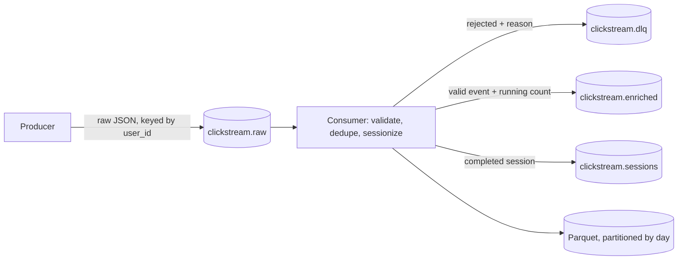

# kafka-clickstream-pipeline

[](https://github.com/DruvaSaiKumar/kafka-clickstream-pipeline/actions/workflows/ci.yml)

Real-time clickstream sessionization on Kafka: a producer publishes raw events, a consumer
validates them, deduplicates, groups a user's activity into sessions with an inactivity gap, and
writes the result to Kafka and to partitioned Parquet.

This is a personal project on synthetic data. It runs against a real Kafka broker; nothing here is
mocked or stubbed. CI runs the whole thing against a live Kafka service container, and locally I
ran it against an actual Kafka broker too (details on how, below).

## Architecture



| Stage | What happens |
|---|---|
| Producer | Publishes raw event lines, partitioned by `user_id` so one user's events land in order on one partition. Does not validate — an edge collector shouldn't need to understand the schema to accept data |
| Consumer | Parses and validates each event; invalid ones go to a dead-letter topic with the reason. Valid ones are checked against an in-memory set of seen `event_id`s (duplicates are counted and flagged, not reprocessed), then fed into a session store keyed by `user_id` |
| Session store | Plain Python (`windowing.py`, no Kafka import): a session closes when the client sends a new `session_id`, or when a configurable inactivity gap passes. A closed session is emitted once, with its event count, unique URLs, and purchase total |
| Sinks | Every valid event goes to `clickstream.enriched`; every completed session goes to `clickstream.sessions` and to a Parquet file partitioned by day |

## Run it

Needs Python 3.10+ and a Kafka broker. `docker compose up -d` starts one (KRaft mode, no
Zookeeper, using the official `apache/kafka` image):

```bash
docker compose up -d
pip install -e .
python -m scripts.run_demo
```

Real output from a run against a freshly started broker:

```
Generated 830 lines. Injected defects: {'missing_user_id': 8, 'bad_event_type': 6, 'bad_device': 5,
'naive_timestamp': 6, 'purchase_missing_value': 7, 'negative_value': 4, 'value_on_non_purchase': 5,
'not_json': 4, 'duplicate_events': 10}
Produced: {'sent': 830, 'delivered': 830}

Consumed:            830
Valid (incl. dupes): 785
Duplicates detected: 10
Rejected to DLQ:     45
    5  device 'SMART_TV' is not one of ['DESKTOP', 'MOBILE', 'TABLET']
    6  event_ts has no UTC offset
    6  event_type 'SCROLL' is not one of ['ADD_TO_CART', 'CLICK', 'ERROR', 'PAGE_VIEW', 'PURCHASE']
    4  invalid JSON
    8  user_id is missing or not a non-empty string
    7  value is required and must be a number for PURCHASE events
    4  value must be absent for CLICK events
    1  value must be absent for PAGE_VIEW events
    4  value must not be negative
Sessions completed:  150
Parquet files:       ['data/sessions/dt=2024-06-01/part-0.parquet']
Consumer lag:        {'clickstream.raw': 0}

RESULT: PASS
```

`scripts/generate_events`-style injection is seeded, so the defect counts above are exact and
`tests/test_integration.py` asserts them, along with the DLQ, enriched, and session topics actually
containing what the counts say they should.

## What the numbers mean

- **830 lines produced, 785 valid (including 10 duplicates), 45 rejected.** 785 + 45 = 830.
- **45 rejected, broken down by reason** — every validation rule in `schema.py` is exercised by at
  least one injected defect, and the DLQ carries the original raw value alongside the reason.
- **150 sessions from 150 simulated users** — in this run every user's short synthetic browsing
  session closes as a single session (none of them idle out or send a second `session_id`); the
  windowing unit tests cover the cases where a session splits in two.
- **Consumer lag 0** — the consumer processed everything and committed every offset before the run
  ended.

## Tests

```bash
docker compose up -d
pip install -e .[dev]
pytest -q -rs
```

| File | What it checks |
|---|---|
| `tests/test_schema.py` | Every validation rule, including the PURCHASE/value cross-field rule, with no Kafka involved |
| `tests/test_windowing.py` | Session boundaries: accumulation, inactivity-gap close, client-side session rotation, idle expiry, purchase totals — pure Python, no Kafka |
| `tests/test_integration.py` | Runs the real pipeline against a live broker: produces, consumes, and checks the DLQ, enriched, and session topics plus the Parquet output against the exact injected counts; also checks that `ensure_topics` is safely re-runnable and that the producer actually raises against an unreachable broker |

Tests that need Kafka are skipped with a clear reason if no broker is reachable at
`KAFKA_BOOTSTRAP` (default `localhost:9092`); they are not skipped in CI or in my own verification —
see [docs/design-decisions.md](docs/design-decisions.md) for exactly what ran where, including a
real bug this project's own bootstrap surfaced and how it was fixed.

## Operating it

```bash
python -m scripts.lag_monitor --topic clickstream.raw --group clickstream-sessionizer
```

Reports how many messages a consumer group is behind on a topic — the same question you'd ask of
any Kafka consumer in production.

## Layout

```
src/clickstream/   schema, windowing (pure Python), generator, producer, consumer, admin, parquet sink
scripts/           run_demo.py, lag_monitor.py
tests/             pytest suite (unit + live-broker integration)
docker-compose.yml single-node Kafka (KRaft), for running this locally
docs/              design decisions, including a real bug found and fixed during development
```

## Limitations

- One broker, replication factor 1. Nothing here has been tested against a multi-broker cluster.
- At-least-once delivery with an in-memory duplicate guard that does not survive a restart — spelled
  out in [docs/design-decisions.md](docs/design-decisions.md).
- Session state lives in the consumer process's memory; a crash loses any still-open session.
- No load or throughput testing; volumes here are a few hundred to a few thousand events.

## License

MIT
